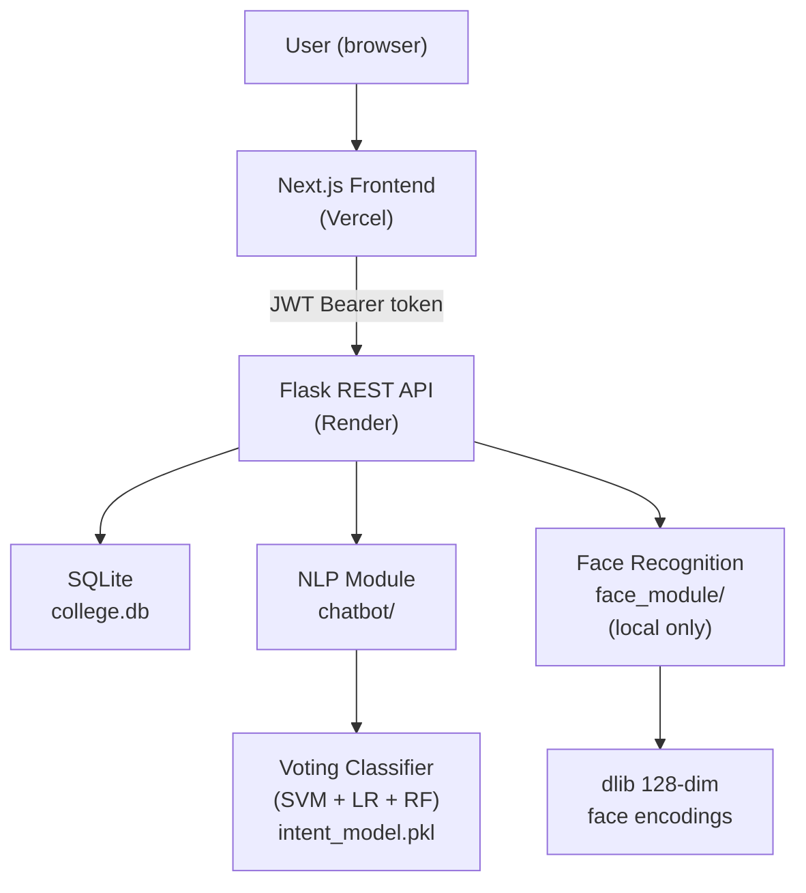
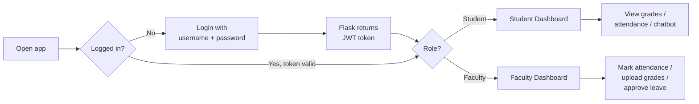
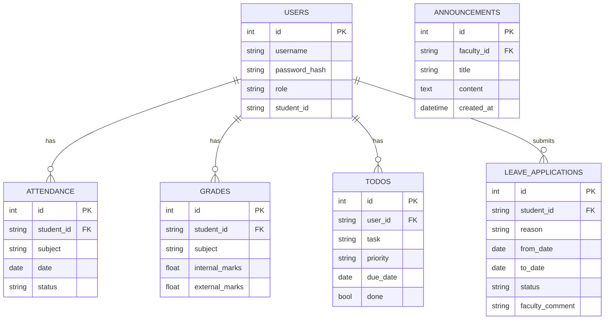

<div align="center">

# 🎓 Smart College Assistant

**An AI-powered college management system — bilingual chatbot, face-recognition attendance, and role-based dashboards for students and faculty.**

[](https://smart-college-assistant-hazel.vercel.app/dashboard)


</div>

---

## Quick Links

- [Demo](#demo)
- [Features](#features)
- [How It Works](#how-it-works)
- [Tech Stack](#tech-stack)
- [Engineering Highlights](#engineering-highlights)
- [Challenges I Solved](#challenges-i-solved)
- [Limitations](#limitations)
- [Roadmap](#roadmap)
- [Run Locally](#run-locally)
- [Deploy](#deploy)
- [API Reference](#api-reference)
- [Project Structure](#project-structure)
- [Testing](#testing)
- [About](#about)

---

## Demo

<!-- TODO: record a 30-second screen capture, save as docs/demo.mp4, then uncomment:
[](docs/demo.mp4)
-->

> **Try it live:** [smart-college-assistant-hazel.vercel.app/dashboard](https://smart-college-assistant-hazel.vercel.app/dashboard)
>
> | Role | Username | Password |
> |------|----------|----------|
> | Faculty | FAC001 | faculty123 |
> | Student | STU001 | student123 |


## Features

| | Feature | What it does |
|-|---------|--------------|
| 🤖 | **Bilingual NLP Chatbot** | Answers college queries in English and Hindi using a trained ensemble classifier |
| 📸 | **Face Recognition Attendance** | Marks attendance via webcam — 128-dimension face encodings stored in SQLite |
| 🎓 | **Student Dashboard** | View attendance, grades, announcements, and planner in one place |
| 👩‍🏫 | **Faculty Dashboard** | Mark attendance, upload grades, post announcements, approve leave |
| 📊 | **Analytics & Charts** | Bar, line, and pie charts for grade distribution and attendance trends |
| 🧮 | **Internal Marks Calculator** | 40 % internal + 60 % external formula with pass/fail prediction |
| 📅 | **Smart Attendance Predictor** | Shows how many more classes to attend to reach 75 %, and skip budget |
| 📝 | **Leave Application System** | Students apply → faculty approve or reject with a comment |
| ✅ | **Monthly Planner & Reminders** | Priority-tagged to-dos and date-based reminders |
| 🌙 | **Dark / Light Mode** | Persisted toggle across the whole UI |

---

## How It Works

### Architecture



### Main User Flow



### Database Schema (ER Diagram)



<details>
<summary>Step-by-step explanation</summary>

1. **Login** — User submits username + password. Flask hashes the password, checks against the `users` table, and returns a signed JWT (24-hour expiry).
2. **Frontend stores the token** in `localStorage` and sends it as `Authorization: Bearer <token>` on every API call.
3. **Flask validates the token** on protected routes using a decorator. If the token is missing or expired, it returns 401 and the frontend redirects to login.
4. **Chatbot flow** — The message is vectorized with TF-IDF (n-grams 1–3, 5 000 features), classified by the Voting Classifier, and the matched intent triggers a response from the response lookup.
5. **Face attendance flow** — The browser captures a webcam frame and sends it as a base-64 image. The backend decodes it, extracts a 128-dimension face encoding with dlib, and compares it against stored encodings (Euclidean distance ≤ 0.50). A match marks attendance.
6. **Dashboard data** — All tabs (grades, attendance, analytics) call dedicated REST endpoints. The frontend assembles Recharts graphs from the JSON responses.

</details>

---

## Tech Stack

| Layer | Technology | Why I chose it |
|-------|-----------|----------------|
| **Frontend** | Next.js 16, TypeScript | App Router, server components, type safety |
| **UI** | Tailwind CSS, shadcn/ui | Rapid styling with accessible, composable components |
| **Charts** | Recharts | React-native, easy to customise |
| **Backend** | Flask 3.1, Python 3.12 | Lightweight, easy to integrate ML models |
| **Auth** | JWT (PyJWT) | Stateless — works across different domains (Vercel + Render) |
| **Database** | SQLite | Zero-config, good enough for a campus-scale demo |
| **NLP** | scikit-learn 1.8, TF-IDF | Fast to train, interpretable, runs on free-tier CPU |
| **Face recognition** | dlib 20.0.0, face_recognition 1.3.0, OpenCV 4.13 | State-of-the-art 128-dim encodings, Euclidean distance matching |
| **Frontend deploy** | Vercel | Auto-deploy on push, edge CDN |
| **Backend deploy** | Render (free tier) | Always-on URL, easy Flask support |

---

## Engineering Highlights

- **JWT across domains.** The app originally used Flask sessions, which break on cross-domain requests (Vercel ≠ Render). Switching to JWT and sending `Authorization: Bearer <token>` headers fixed CORS completely without relaxing security.
- **Bilingual dataset from scratch.** The NLP dataset (500 samples, 10 intents, English + Hindi) was hand-curated to cover real student queries. TF-IDF with n-gram range (1, 3) captures short Hindi phrases that unigrams miss.
- **Ensemble classifier beats any single model.** A soft-voting combination of SVM (linear kernel), Logistic Regression, and Random Forest (200 trees) reaches ~80 % accuracy on the held-out test set where no single model does as well.
- **Face encodings stored as BLOBs.** 128-float dlib encodings are serialised with `pickle` and stored directly in SQLite. No external vector database is needed for a single-campus use case, keeping the stack simple.
- **Cloudless face module.** dlib + OpenCV add ~8 GB of memory at install time — well beyond Render's free tier. The face module runs locally; the deployed build has a separate `requirements.txt` that excludes those packages so the backend deploys cleanly.
- **Recharts analytics built from API data.** The frontend never hard-codes sample data. Every chart fetches live grades and attendance from the backend, so the analytics are always current.
- **Role-based route protection.** Both the Next.js frontend and the Flask backend enforce role checks independently. The frontend redirects unauthorised routes; the backend returns 403 even if someone calls the API directly.

---

## Challenges I Solved

<details>
<summary>🔴 dlib would not install on Windows — CMake missing</summary>

**Problem:** `pip install dlib` fails with "CMake is not installed on your system!" on Windows, even after `pip install cmake`.

**Fix:** Download and install CMake from [cmake.org](https://cmake.org), tick "Add CMake to system PATH", then reopen the terminal. After that, `pip install dlib` compiles cleanly inside the Python 3.12 venv.

**Lesson:** `pip install cmake` installs a broken Python-bundled copy. Always use the official installer for native build tools.

</details>

<details>
<summary>🔴 CORS errors after deployment — login worked locally, broke in production</summary>

**Problem:** The Flask backend used `session` objects. Sessions rely on cookies, which browsers block by default across different domains. Every API call from Vercel to Render returned a 401.

**Fix:** Replaced Flask sessions with JWT tokens. The login route now returns `{ token, user }`. The frontend stores the token in `localStorage` and attaches it as `Authorization: Bearer <token>` on every request.

**Lesson:** Never rely on cookies for cross-domain APIs. JWT is the right primitive for a decoupled frontend + backend.

</details>

<details>
<summary>🟡 Chatbot not loading — module import error in deployed backend</summary>

**Problem:** `from chatbot.predictor import predict` raised `ModuleNotFoundError` when Render started the app, even though the file existed.

**Fix:** Added `sys.path.insert(0, os.path.dirname(__file__))` at the top of `main.py` so Python resolves sibling packages correctly regardless of the working directory the process starts from.

**Lesson:** Relative imports depend on how Python is invoked. Explicit `sys.path` manipulation makes the module resolution deterministic.

</details>

<details>
<summary>🟡 Git push rejected — remote had commits the local repo did not</summary>

**Problem:** `git push` failed with "Updates were rejected because the remote contains work that you do not have locally."

**Fix:**
```
git pull origin main --rebase
git push origin main
```

**Lesson:** Always pull before pushing, especially when the repo was initialised on GitHub with a README.

</details>

---

## Limitations

- **Face recognition is local only.** dlib requires ~8 GB of packages at install time, which exceeds Render's free-tier RAM. The deployed backend omits it. Running locally with the full `venv312` environment restores this feature.
- **SQLite is not production-ready.** SQLite has no concurrent-write support. For a real deployment with many users, migrate to PostgreSQL.
- **Chatbot covers 10 intents.** Queries outside those intents (e.g., events, clubs, hostel complaints) return a fallback response. The model was trained on a hand-curated dataset; it is not a general LLM.
- **No real-time updates.** The dashboard does not use WebSockets or server-sent events. Refreshing the page fetches the latest data.
- **Free-tier cold start.** The Render free tier sleeps after 15 minutes of inactivity. The first request after sleep takes ~30 seconds.

---

## Roadmap

- [x] NLP chatbot with bilingual dataset
- [x] Face recognition attendance (local)
- [x] Student dashboard (attendance, grades, planner, chatbot)
- [x] Faculty dashboard (mark attendance, upload grades, announcements)
- [x] Analytics with Recharts charts
- [x] Internal marks calculator
- [x] Smart attendance predictor
- [x] Leave application system
- [x] JWT-based auth for cross-domain deployment
- [x] Dark / light mode toggle
- [ ] Assignment tracker
- [ ] Timetable manager
- [ ] AI Study Assistant (Grok API integration)
- [ ] PostgreSQL for production
- [ ] Cloud face recognition (serverless GPU endpoint)
- [ ] Push notifications for announcements

---

## Run Locally

### Prerequisites

| Tool | Version |
|------|---------|
| Python | 3.12 |
| Node.js | 18 + |
| CMake | latest (for face recognition only) |
| Visual C++ Build Tools | latest (for dlib on Windows) |

### Backend

```bash
# 1. Clone the repo
git clone https://github.com/heena-jindal/smart-college-assistant.git
cd smart-college-assistant

# 2. Create and activate a Python 3.12 virtual environment
py -3.12 -m venv venv312
# Windows
venv312\Scripts\activate
# macOS / Linux
source venv312/bin/activate

# 3. Install dependencies
pip install -r requirements.txt

# 4. Start Flask
python main.py
# Runs on http://localhost:5000
```

### Frontend

```bash
cd frontend

# 5. Install Node packages
npm install

# 6. Create a local environment file
cp .env.example .env.local
# Edit .env.local — see environment variables below

# 7. Start Next.js dev server
npm run dev
# Runs on http://localhost:3000
```

<details>
<summary>Environment variables</summary>

**frontend/.env.local**

| Variable | Example value | Notes |
|----------|--------------|-------|
| `NEXT_PUBLIC_API_URL` | `http://localhost:5000` | Point to Render URL in production |

**backend (main.py reads from environment)**

| Variable | Example value | Notes |
|----------|--------------|-------|
| `JWT_SECRET_KEY` | `change-me-in-production` | Any random string; keep it secret |
| `PORT` | `5000` | Render sets this automatically |

</details>

---

## Deploy

<details>
<summary>Deploy backend to Render</summary>

1. Push code to GitHub (see [Project Structure](#project-structure) — make sure `requirements.txt` does NOT include dlib/opencv).
2. Create a new **Web Service** on [render.com](https://render.com).
3. Connect the GitHub repo.
4. Set **Build Command:** `pip install -r requirements.txt`
5. Set **Start Command:** `python main.py`
6. Add environment variable `JWT_SECRET_KEY` in the Render dashboard.
7. Copy the service URL (e.g. `https://smart-college-assistant-xxxx.onrender.com`).

</details>

<details>
<summary>Deploy frontend to Vercel</summary>

1. Import the repo in [vercel.com](https://vercel.com).
2. Set **Root Directory** to `frontend`.
3. Add environment variable:
   - `NEXT_PUBLIC_API_URL` = your Render service URL
4. Click Deploy.

</details>

---

## API Reference

<details>
<summary>All endpoints</summary>

| Method | Path | Auth | Description |
|--------|------|------|-------------|
| `POST` | `/auth/login` | ❌ | Login — returns `{ token, user }` |
| `GET` | `/api/students` | ✅ Faculty | List all students |
| `GET` | `/api/attendance/<student_id>` | ✅ | Get attendance records |
| `POST` | `/api/attendance` | ✅ Faculty | Mark attendance |
| `GET` | `/api/grades/<student_id>` | ✅ | Get grades |
| `POST` | `/api/grades` | ✅ Faculty | Upload / update grades |
| `GET` | `/api/announcements` | ✅ | List announcements |
| `POST` | `/api/announcements` | ✅ Faculty | Post announcement |
| `GET` | `/api/todos/<user_id>` | ✅ | Get to-do list |
| `POST` | `/api/todos` | ✅ | Add to-do item |
| `PUT` | `/api/todos/<id>` | ✅ | Update to-do item |
| `DELETE` | `/api/todos/<id>` | ✅ | Delete to-do item |
| `GET` | `/api/reminders/<user_id>` | ✅ | Get reminders |
| `POST` | `/api/reminders` | ✅ | Add reminder |
| `GET` | `/api/leave` | ✅ | Get leave applications |
| `POST` | `/api/leave` | ✅ Student | Submit leave application |
| `PUT` | `/api/leave/<id>` | ✅ Faculty | Approve / reject leave |
| `POST` | `/api/chat` | ❌ | Chatbot — send message, get intent + response |
| `POST` | `/api/face/register` | ✅ Faculty | Register a student's face encoding |
| `POST` | `/api/face/recognize` | ✅ | Identify a face from a webcam frame |

✅ = requires `Authorization: Bearer <token>` header

</details>

---

## Project Structure

<details>
<summary>Folder tree</summary>

```
smart-college-assistant/
│
├── main.py                        # Flask app — all REST routes
├── requirements.txt               # Lightweight deps (no dlib for cloud deploy)
├── Procfile                       # Render start command
├── college.db                     # SQLite database (gitignored)
│
├── chatbot/
│   ├── train.py                   # Train the Voting Classifier
│   ├── predictor.py               # Load model + predict intent
│   ├── response.py                # Intent → response lookup
│   ├── college_dataset.csv        # 500-row bilingual training data
│   ├── intent_model.pkl           # Trained model (gitignored)
│   └── vectorizer.pkl             # TF-IDF vectorizer (gitignored)
│
├── face_module/
│   ├── register_face.py           # Capture + store face encoding
│   ├── recognize_face.py          # Compare webcam frame to stored encodings
│   └── database.py                # SQLite helpers for face BLOBs
│
└── frontend/
    ├── app/
    │   ├── page.tsx               # Standalone chatbot UI
    │   ├── dashboard/
    │   │   └── page.tsx           # Main dashboard (student + faculty)
    │   └── api/
    │       └── chat/route.ts      # Next.js API route — proxies to Flask
    ├── components/
    │   ├── chat-container.tsx     # Chat UI state + message loop
    │   ├── chat-message.tsx       # Renders one message bubble
    │   ├── chat-input.tsx         # Input bar
    │   ├── chat-welcome.tsx       # Suggestion chips on empty state
    │   ├── typing-indicator.tsx   # Animated dots while waiting
    │   └── ui/                    # shadcn/ui component library
    ├── hooks/                     # use-mobile, use-toast
    ├── lib/utils.ts               # Tailwind class merging utility
    ├── styles/globals.css         # CSS variables + dark mode tokens
    ├── next.config.mjs
    └── package.json
```

</details>

---

## Testing

<details>
<summary>What I tested</summary>

- [x] Login with valid credentials returns JWT token
- [x] Login with wrong password returns 401
- [x] Expired token returns 401 on protected routes
- [x] Chatbot responds in both English and Hindi
- [x] Chatbot returns a fallback for out-of-scope queries
- [x] Attendance marked by faculty shows on student dashboard
- [x] Grade upload appears in student grades tab
- [x] Internal marks calculator: 40 % internal + 60 % external formula verified manually
- [x] Attendance predictor: skip budget and classes-needed are correct at 60 %, 70 %, 80 % attendance
- [x] Leave application: student submits → faculty sees it → faculty approves → student sees updated status
- [x] Dark / light mode toggle persists across page refresh
- [x] Cross-domain JWT auth: Vercel frontend → Render backend (no CORS errors)
- [x] Face recognition: registers known face, identifies it on next capture (local env only)

</details>

---

## About

Built by **Heena Jindal** — third-year B.Tech student in AI & ML at Delhi Technical Campus (GGSIPU).

<!-- Add your links below -->
[](https://linkedin.com/in/heena-jindal)
[](https://heena-portfolio-ten.vercel.app)
[](mailto:hjindal918@gmail.com)

---

<div align="center">
  <sub>If this project helped you, please consider giving it a ⭐ — it helps others find it.</sub>
</div>
